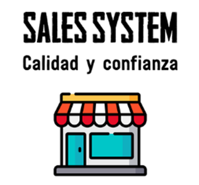
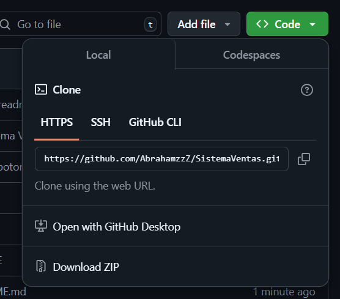

# 🌲 Sistema de Ventas de Productos



<br>

<div>
  <a href="https://github.com/AbrahamzzZ/SistemaVentas/actions/workflows/pruebas-unitarias.yml">
    
  </a>
  
  <a href="./LICENSE">
    
  </a>
</div>

Aplicación de escritorio para la gestión de ventas, compras e inventario de un supermercado: productos, categorías, clientes, proveedores, transportistas, sucursales, ofertas, usuarios con roles y permisos, reportes en PDF y Excel, y estadísticas.

Grupo de Construcción de Software Sof-Ve-6-2

## 📝 Tabla de Contenidos

- [🧱 Arquitectura](#-arquitectura)
- [📦 Requisitos](#-requisitos)
- [📥 Clonar el repositorio](#-clonar-el-repositorio)
- [💾 Instalación de la base de datos](#-instalación-de-la-base-de-datos)
- [🚀 Ejecución del proyecto](#-ejecución-del-proyecto)
- [🧪 Pruebas unitarias](#-pruebas-unitarias)
- [📝 Licencia](#-licencia)

## 🧱 Arquitectura

La solución (`App/SistemaVenta.sln`) está organizada en capas:

| Proyecto | Descripción |
|---|---|
| `Presentacion` | Aplicación Windows Forms (.NET 10). |
| `Negocios` | Reglas de negocio y validaciones. |
| `Datos` | Acceso a SQL Server mediante procedimientos almacenados. |
| `Entidad` | Clases del modelo (Producto, Venta, Cliente, ...). |
| `Test` | Pruebas unitarias de la capa de negocio (MSTest + Moq). |

## 📦 Requisitos

- [Visual Studio 2026](https://visualstudio.microsoft.com/es/downloads/) con la carga de trabajo **Desarrollo de escritorio de .NET**
- [.NET 10 SDK](https://dotnet.microsoft.com/download/dotnet/10.0)
- [SQL Server](https://www.microsoft.com/es-es/sql-server/sql-server-downloads) (Express o LocalDB son suficientes)
- [Git](https://git-scm.com/downloads)

> [!NOTE]
> Para solo ejecutar la aplicación, sin compilarla, basta con el [.NET 10 Desktop Runtime](https://dotnet.microsoft.com/download/dotnet/10.0).

## 📥 Clonar el repositorio

```sh
git clone https://github.com/AbrahamzzZ/SistemaVentas.git
cd SistemaVentas
```

También puede descargar el ZIP desde el botón **Code → Download ZIP** del repositorio.



## 💾 Instalación de la base de datos

El script `App/Database/DB_SISTEMA_VENTAS.sql` crea la base de datos `Sistema_Ventas` con sus tablas, procedimientos almacenados y datos de ejemplo.

Con autenticación de Windows:

```sh
sqlcmd -S [nombre_servidor] -E -f 1252 -i "App/Database/DB_SISTEMA_VENTAS.sql"
```

Con autenticación de SQL Server:

```sh
sqlcmd -S [nombre_servidor] -U [usuario] -P [contraseña] -f 1252 -i "App/Database/DB_SISTEMA_VENTAS.sql"
```

> [!WARNING]
> ⚠ Reemplace `[nombre_servidor]` por el de su instancia, por ejemplo `localhost\SQLEXPRESS` o `(localdb)\MSSQLLocalDB`.
> El parámetro `-f 1252` es necesario para que las tildes de los mensajes se guarden correctamente.

## 🚀 Ejecución del proyecto

1. Configure la cadena de conexión `ConexionBD` en `App/Presentacion/App.config` con el nombre de su servidor:

   ```xml
   <add name="ConexionBD" connectionString="server=localhost\SQLEXPRESS;database=Sistema_Ventas;integrated security=true;TrustServerCertificate=true;" />
   ```

   También puede definir la variable de entorno `SISTEMA_VENTAS_DB` con la cadena de conexión; si existe, tiene prioridad sobre `App.config`.

2. Ejecute la aplicación desde Visual Studio (F5) o con:

   ```sh
   dotnet run --project App/Presentacion
   ```

## 🧪 Pruebas unitarias

Las pruebas validan las reglas de la capa de negocio usando mocks de la capa de datos, por lo que no necesitan una base de datos:

```sh
dotnet test App/Test
```

En cada Pull Request hacia `main`, GitHub Actions compila y ejecuta las pruebas automáticamente ([`.github/workflows/pruebas-unitarias.yml`](.github/workflows/pruebas-unitarias.yml)).

## 📝 Licencia

Este proyecto está licenciado bajo la licencia **MIT**. Consulte el archivo [LICENSE](./LICENSE) para más información.
